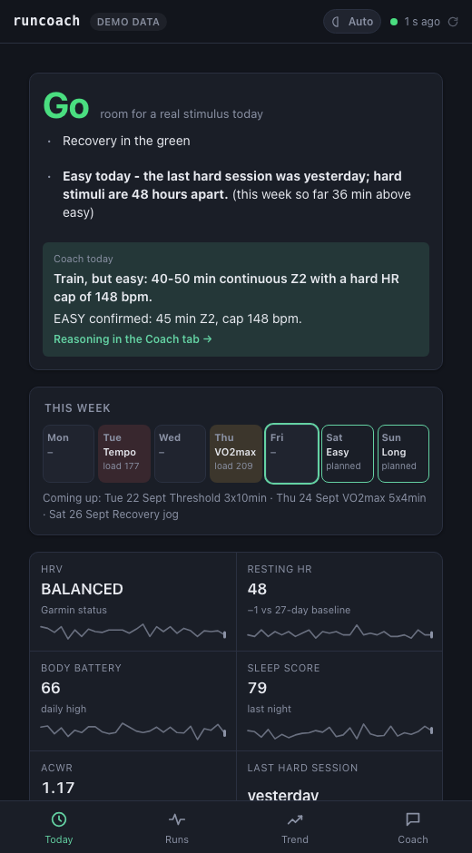
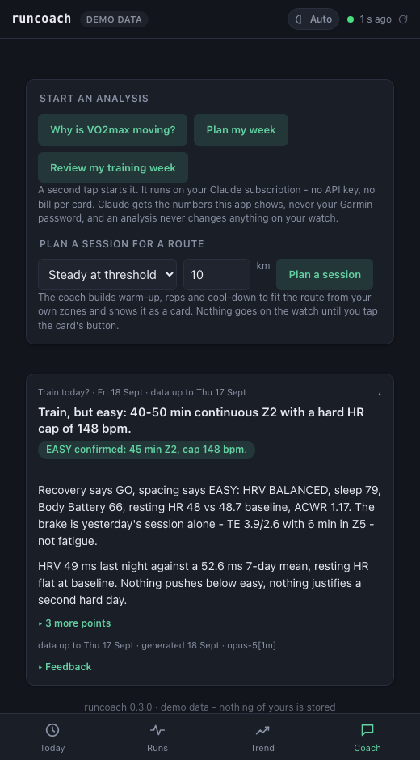
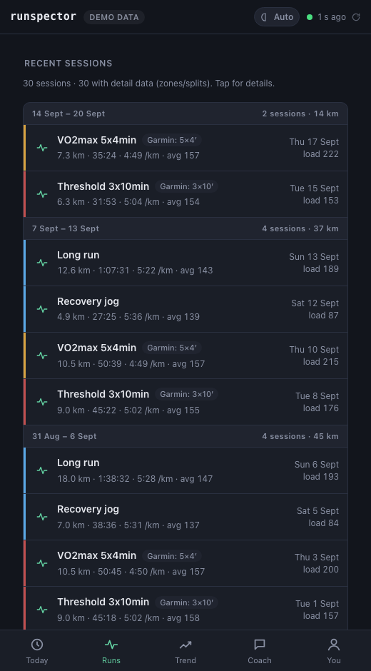
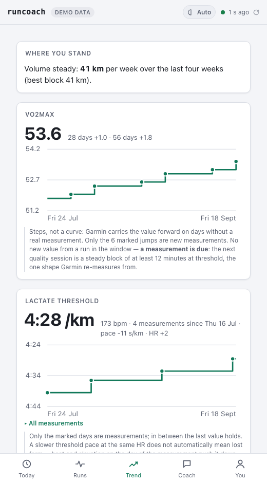
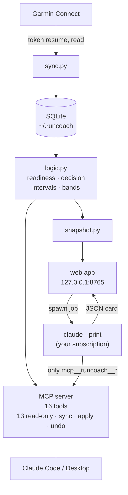

# runcoach-ai

[](https://github.com/edxleon/runcoach-ai/actions/workflows/ci.yml)
[](evals/RESULTS.md)
[](LICENSE)

**A local-first AI running coach for your Garmin data — powered by the Claude subscription you already have.**

I came to running late, and for a long time my VO2max would not move. I had always trained a lot,
and it had never really shown up in that number — so I assumed more of the same would eventually
work. It did not. I was training wrong, in ways the watch on my wrist had the data to show me and
never did: Garmin collects everything and explains nothing.

That was the idea. The data is already there; let an AI read it and coach — with the training aimed
squarely at raising VO2max rather than at collecting kilometres, and with the decision rules written
down so the coach explains them instead of improvising. This repository started as that tool for one
athlete. It is now installable for anyone with a Garmin watch and a Claude subscription.

No cloud backend, no API key, no Docker. One Python package that syncs your Garmin data into a
SQLite file on your machine, shows it in a small web app, and lets Claude act as your coach —
with a deterministic readiness engine underneath, so the AI explains decisions instead of inventing them.

<sub>**If you came for the engineering rather than the running**, the five decisions this repository is
actually about — each with the measurement behind it — are in
[Design decisions](#design-decisions). The short version: the verdict is
[pure code](src/runcoach/logic.py) and only the *explanation* is AI · the agent runs on
[an allowlist, not a denylist](src/runcoach/web/agent.py) (`--tools ""`, one MCP server, empty temp cwd) ·
[prompts are regression-tested](evals/) by an LLM-as-judge suite whose last run is
[in the repo](evals/RESULTS.md) · quantities that exist in two languages are pinned by
[executing the shipped JavaScript against the Python](tests/test_js_python_contract.py) · and the
[release gate](scripts/pii_gate.py) scans binaries too, with a false-positive counter-case. CI runs lint,
912 tests, 72 frontend tests and that gate on three operating systems and two Python versions, with every
action pinned to a commit SHA — and a second job that [builds the wheel, installs it as a user would and
drives the installed executable through this quick start](scripts/install_check.py) on all three systems,
because the suite proves the code and only an install proves the package.</sub>

https://github.com/user-attachments/assets/81389835-8d7b-4c97-99d5-e23ac4540549

<sub>The 89-second demo, with voice-over: the synthetic demo athlete, rebuilt from this repo by <code>scripts/video.py</code>
(<a href="docs/video/runcoach-demo.mp4">file</a>). No player above? The GitHub mobile app shows no videos:
<a href="https://cdn.jsdelivr.net/gh/edxleon/runcoach-ai@v0.3.0/docs/video/runcoach-demo.mp4">▶ play the demo</a> in the browser.</sub>

<p>
  
  
  
  
</p>

<sub>The built-in synthetic athlete (`runcoach serve --demo`). Every image is regenerated by
<code>python scripts/screenshots.py</code>, and the coach card is an unedited agent run against that same
demo database, kept in <a href="docs/screenshots/demo-card.json">demo-card.json</a> so the picture cannot
drift from the app — the numbers it cites (HRV balanced, Body Battery 66, resting HR 48, ACWR 1.17) are the
ones on the Today tab beside it. <code>docs/screenshots/</code> has each of the five tabs full-length, in both
themes — e.g. <a href="docs/screenshots/today.png">today.png</a> and
<a href="docs/screenshots/today-light.png">today-light.png</a>.</sub>

> Not affiliated with Garmin. Uses the unofficial
> [python-garminconnect](https://github.com/cyberjunky/python-garminconnect) library against your own account.
> This is a training tool, not medical advice.

## Quick start

```bash
# 1. install (needs uv: https://docs.astral.sh/uv/)
uv tool install git+https://github.com/edxleon/runcoach-ai

# 2. look around without any account
runcoach serve --demo

# 3. the real thing
runcoach serve        # first start: asks for the Garmin login (e-mail, password, MFA code -
                      # only session tokens are stored), checks Claude, then opens
                      # http://127.0.0.1:8765 and syncs the last 30 days in the background
```

**The Claude subscription is not connected inside runcoach.** Coach cards run on the
[Claude Code](https://claude.com/claude-code) CLI on your machine, signed in with your plan: install
it and run `claude auth login` once. `runcoach serve` checks that at start (and offers the login when
it is missing), the Coach tab says what is missing, and there is no API key anywhere. Garmin works the
same way: `runcoach login` signs in from any terminal, and a running app picks it up on ↻ - no restart.

`runcoach doctor` tells you what is missing — it checks the Garmin session by actually
using it, and reports the data age, because a token that quietly expired is how this kind of app dies.
Use `runcoach doctor --offline` to skip the Garmin call. Exit 1 means something needs fixing, so
`runcoach doctor || notify-me` works in a cron; a missing Claude CLI is reported but does not set it,
since everything except the coach cards works without it.

Use the same data in Claude Code or Claude Desktop as an MCP server:

```bash
claude mcp add runcoach -- runcoach mcp
# then just ask: "should I train today?"
# or: "plan me an easy 40 minutes for tomorrow" - you see the session, and it goes
# on your watch only after you say yes ("take it back off" undoes it)
```

Keep it fresh without the app (cron / Task Scheduler): `runcoach sync`.

Later on:

```bash
uv tool upgrade runcoach-ai     # newer code; your data and Garmin session stay where they are
uv tool uninstall runcoach-ai   # removes the program only - delete ~/.runcoach yourself if you want the data gone
```

`uv tool install` takes whatever is on `main`; pin a release instead with
`uv tool install git+https://github.com/edxleon/runcoach-ai@v0.4.0`.

## Before you start: the usual worries

- **Is my Garmin password stored?** No. It goes to Garmin once, to sign in. Garmin answers with a
  session token, and only that is kept, on your computer, in a folder only your user account can read.
- **Does it cost anything extra?** runcoach is free (MIT). Coach cards use your Claude plan the way any
  Claude Code use does, with no API key and no bill per card. Without Claude, everything except the
  cards still works.
- **What does Claude see?** The numbers this app shows (readiness, recent runs, zones, weekly load),
  and only when you start a card or ask in Claude Code. It never sees your Garmin password, the
  session token or any raw file. It reaches Claude through your own account, under your plan's terms.
- **Can it mess up my watch or my calendar?** Reading is all it does on its own. Something goes to
  Garmin only when you press "Put on watch" or say yes in Claude Code, and then only the session
  shown to you. "Take off watch" removes it again. The coach's own card runs cannot write at all.
- **Can Garmin block my account?** runcoach signs in through
  [python-garminconnect](https://github.com/cyberjunky/python-garminconnect), a community library
  that Garmin does not officially support. A daily sync makes about 25-40 requests and the first one
  (a month of data) a few hundred. It pauses between workout downloads, never fetches more than 90 days,
  and stops at the first rate-limit answer instead of retrying into it. That is no guarantee, but it
  is not scraping either.
- **Is this medical advice?** No. It is a training tool. Pain, dizziness or anything that feels wrong
  goes to a doctor, and the coach says so instead of planning around it.
- **How do I remove everything?** Delete `~/.runcoach` (the app's footer shows the folder) and run
  `uv tool uninstall runcoach-ai`. To cut the token off at Garmin as well, change your Garmin password.

## What you get

| Tab | What it answers |
|---|---|
| **Today** | GO / EASY / REST with the signals behind it, *one* decision sentence for today and, on a hard day, *which* hard session (VO2max intervals, threshold reps, or the steady block Garmin measures VO2max from), your VO2max with the days since it last really changed, this week planned vs. done, last night's sleep, your zone bounds with their origin |
| **Runs** | Every run with its intensity band, real interval structure (`5×4′`, not "5 minutes"), zones, weather, performance condition — and an *Analyze this run* button |
| **Trend** | VO2max as honest steps (and whether a measurement is due), lactate threshold history, weekly hard-minute share vs. an 80/20 target, aerobic efficiency (pace at a fixed heart rate) with spread and trend, volume, polarisation, ACWR, and Garmin's own load focus (its 4-week load per band against its target range) as a second opinion |
| **Coach** | Ask the coach anything in your own words (*what am I doing wrong?*) - a short card, the biggest lever first. One-tap analyses by Claude as short cards that remember the previous card of their kind, accept your 👍/👎, take follow-up questions and can be deleted. Two start here (*Why is VO2max moving? · Review my week*); the other two start where their subject is — *Should I train today?* on the Today tab, *Analyze this run* on a run |
| **You** | **Your week**, the foundation the planner goes by: runs per week, your days, long run, days you can't run, another sport - read from your history and kept up to date, and yours to change: what you set wins until you hand it back. **For your coach**: a note in your own words ("gym Mon, Wed, Fri", "less time until December") the coach reads before every answer. And what the coach has learned about you, each with its evidence: how consistent you are, your intensity pattern, the VO2max trend, Garmin's load focus, resting-HR baseline and zones - and since when, where something changed. Every card and the MCP tool `get_athlete_profile` read all three |

## How it works



## Design decisions

**The verdict is code, the explanation is AI.** GO/EASY/REST, today's decision, interval detection and
intensity bands are pure functions in [`logic.py`](src/runcoach/logic.py) — unit-tested, no network, no
LLM. The facts *and* the decision are computed once there, and the agent is handed the finished
decision through `get_training_readiness` rather than left to derive its own: a coach card is a reading
of that decision, not a second, independently produced verdict. Claude may explain it, add the context a
rule cannot — or disagree, in which case it has to say which number it disagrees with. Claude's job is
the part rules are bad at: weighing a conflict, phrasing a plan, answering a follow-up.

**Your subscription, not an API key.** Coach jobs run `claude --print` as a subprocess. There is no key
to leak, no per-token bill, nothing to configure. If your quota is exhausted the job *waits* for the next
window instead of failing.

**The agent gets an allowlist, not a denylist.** Workout titles are attacker-controlled text that ends
up in a prompt. So the coach agent runs with `--tools ""` (no Bash, no file access, no web),
`--strict-mcp-config` with exactly one server — this one — and only `mcp__runcoach__*` pre-approved, in an
empty temp directory. The card comes back as JSON and is validated and written by the app, not by the
agent — and an answer produced without a single tool round trip is discarded: a model that cannot reach
the data will otherwise invent it (this was measured, not assumed).
See [`web/agent.py`](src/runcoach/web/agent.py).

What that does and does not buy, stated plainly: an injected workout title **cannot reach anything but
this app's own tools** — no shell, no filesystem, no network, no other MCP server, and no write path
from a card run: every tool is read-only except `sync_garmin`, which triggers authenticated requests to
your own Garmin account and so is worth a rate limit rather than nothing, and `apply_workout`, the one
tool that writes to Garmin — which the app's card runs cannot call at all (`--disallowedTools`, pinned
by a test), because applying a proposal is a human's click on the card or their word in a Claude Code
session, never a job's decision. What it **can** still do is influence
what a card says — and the card is the product. And cards are remembered: the previous card of the same
kind is fed back as context for the next one, so a bad card echoes forward until you delete it (the UI
has a delete button per card).

**Aggregates for the model, series for the UI.** MCP tools never return day-by-day rows for a period —
daily series bloat a context window and get misread. The agent sees summaries and weekly buckets; only
the frontend, which draws curves, gets points.

**Honest numbers.** A few examples of what that means in practice:
- Garmin carries VO2max forward on days without a measurement, so a change is only reported when the
  value actually varied — never as a difference of window endpoints.
- A self-computed ACWR needs ≥ 21 days *and* ≥ 8 workouts, is labelled `computed`, and may dampen a
  verdict to EASY but never drive REST.
- A GO from fewer than two recovery signals is downgraded: thin data is not green.
- If the sync is stale, today's decision is `unknown` rather than yesterday's verdict in today's clothes.
- An incompletely fetched calendar month does not replace the local mirror ("nothing planned" would be
  a lie from a degraded source).
- Garmin's lactate-threshold pace field is off by a factor of ten; it is normalised, range-checked, and
  loudly dropped if the unit ever changes.
- A planned week lands on the athlete's own days: how many days, which weekdays and the long-run day
  are read from the last eight weeks with running (looking back half a year, and before a pause while
  coming back from one), and the quality sessions keep clear of a weekly other sport and the day after
  it - a gym Tuesday leaves room for one quality session, not two. A rotating every-other-day rhythm
  has no weekdays of its own and is planned in the default rhythm. Each value says where it came from:
  "long run on sat - your longest run fell on sat in 8 of 8 weeks".
- A planned week is sized from the athlete's own running weeks - rolling weeks ending on the day of
  planning, never more than 10 % over the bigger of the last two - and then read against their
  history, in code: the load ratio can hold or unload it, every fourth week is a down week, ten
  days without a run make a return week of easy running only (half the weeks before after more
  than three weeks off), and twenty-eight days without a new VO2max value put a steady block in
  the threshold slot. A budget too small for the planned days plans a shorter week - one quality
  session at three days, never a lone hard one - instead of inflating the sessions. A week with one
  quality session takes the one that is due (VO2max until the zone-5 stimulus is set, then
  threshold, or the measurement). Back from a pause the athlete rebuilds: the step grows from the
  last seven days, not from a median that lags the climb, and there is no down week until the weeks
  are back to 80 % of the level before the pause. A step is never smaller than the week planned
  before it, and a week held or unloaded on the load ratio is never bigger: the median it holds
  rises with every week run above plan, which is what raised the ratio. Each rule is a named
  assumption on the proposal, none of them a prompt's discretion.
  On a hard day the decision also says *which* hard session, from what the last seven days did
  and did not contain; after a pause the day is easy instead.
- Without a measured threshold pace, sessions are sized from Garmin's own 5 km and 10 km predictions
  rather than from a 5:00/km default that fitted one athlete.
- Those rules are run, not only unit-tested: [`evals/sim.py`](evals/sim.py) puts eight synthetic
  athletes - one who follows the plan, one who skips 40 %, one who takes three weeks off, one who
  falls ill, one who always runs harder - through sixteen weeks of the app, day by day against the
  real tools, and checks what a runner would expect of a coach over the whole course. It found the
  two planner bugs above. It cannot tell whether the training works - its body is a toy - and it
  finds only what its data model knows, so the live test on a real account stays.

**Prompts are tested like code.** The coach's behaviour lives in two Markdown files
([`skills/`](src/runcoach/skills)) with an LLM-as-judge regression suite ([`evals/`](evals)):
32 cases such as *"a run already happened today → no second hard session"*, *"warning signs of low energy
availability are not explained away"*, *"an instruction inside a workout name is not followed"*. They run
without Garmin data against the real CLI — though only over those two files, not over the other two
pieces of the shipped prompt (`templates.json` and the JSON-card frame in `web/agent.py`, which
`tests/test_web.py` covers deterministically instead), and under `--safe-mode` on whichever model the
suite is pointed at, neither of which production can use. The framing itself is imported from the app
rather than copied, so the suite cannot drift from what ships. `--no-skills` re-runs a case with the
skill files removed: a case that still passes is testing the model, not the prompt.

**Boring technology.** Python stdlib HTTP server, `sqlite3`, vanilla ES modules, inline SVG charts. No
framework, no build step, no ORM. ~40 SQL queries, all in [`store.py`](src/runcoach/store.py).
Runs on Windows, macOS and Linux (CI matrix).

More detail: [docs/architecture.md](docs/architecture.md).

## Privacy

Everything stays in `~/.runcoach/` (override with `RUNCOACH_HOME`): the SQLite database, Garmin session
tokens, coach cards. Your password is never stored. On Linux and macOS the directory is created `0700`,
so on a shared machine other local accounts cannot read those files; Windows inherits the user profile's
ACL instead. **While `runcoach serve` runs, that no longer covers them:** without a token any local account
or process can ask `127.0.0.1:8765` for your data, and since v0.2 apply or undo a proposal with your
Garmin session. On a machine you share, start it with `RUNCOACH_TOKEN` set - the server then wants the
token on loopback too, and prints the link to open once. The only outbound connections are to Garmin
(sync) and — when *you* trigger a coach card — to Claude through your own CLI session, carrying
aggregated training data. The server binds to `127.0.0.1`; listening on the network requires
`RUNCOACH_TOKEN` and the server refuses to start without it. Note that `--host 0.0.0.0` serves plain
HTTP with no TLS, so on that network the token and everything the app returns travel unencrypted and
readable by anyone who can see the traffic — it is meant for your own phone on your own LAN, not for a
network you do not control.

## Configuration

| Variable | Default | Purpose |
|---|---|---|
| `RUNCOACH_HOME` | `~/.runcoach` | data directory |
| `RUNCOACH_TZ` | system zone | IANA zone for "which day was this run" |
| `RUNCOACH_TOKEN` | – | required for `--host 0.0.0.0` (phone in your home network) |
| `RUNCOACH_MODEL` | CLI default | model for coach cards |
| `RUNCOACH_GARMIN_TOKENS` | `~/.runcoach/garmin` | reuse an existing python-garminconnect token dir |
| `RUNCOACH_AUTOSYNC_MIN` | `30` | in a Claude Code / Desktop chat, `get_training_readiness` syncs first when the last sync is older than this; `0` turns it off |
| `RUNCOACH_QUOTA_WAIT_S` | `3600` | how long a job waits for subscription quota |
| `RUNCOACH_JOB_TIMEOUT_S` | `600` | hard timeout for a single coach job |
| `RUNCOACH_ACTIVITY_BACKFILL_DAYS` | `182` | minimum window of the workout list a sync fetches (your habits look back 26 weeks; zone detail is fetched for the last 35 days) |
| `RUNCOACH_LT_HISTORY_DAYS` | `180` | how far back the lactate-threshold history is fetched |
| `RUNCOACH_LOG` | `WARNING` | log level — set `INFO` or `DEBUG` to watch a sync. `INFO` and `DEBUG` also log every HTTP request of the web app |

Four more (`RUNCOACH_DB`, `RUNCOACH_DEMO`, `RUNCOACH_CLAUDE_CMD`, `RUNCOACH_PII_EXTRA`) exist for
internal plumbing and tests; they are not part of the supported surface.

Optional athlete profile: `runcoach profile --max-hr 182 --goal "sub-50 10k"`. Your week - days
per week, your days, long run, days off, another sport - is set on the You tab (or with
`--days-per-week` and `--long-run-day`); whatever you leave open the planner reads from your
history: the days you usually run, and the weekday your longest run falls on. A day off is never
planned on. The note to your coach is context for the coach, not a rule: the days are what the
planner itself keeps to.

## Development

```bash
git clone https://github.com/edxleon/runcoach-ai && cd runcoach-ai
uv run pytest -q                   # no database server, no network, no Garmin account needed
node --test "web-tests/*.test.mjs" # frontend logic
uv run ruff check                  # lint — config is real and the backlog is zero
uv run python evals/run_evals.py   # prompt regression (uses your Claude subscription)
uv run python scripts/pii_gate.py  # release gate
```

## Status & roadmap

v0.1 was **read-only** towards Garmin. v0.2 adds the write path: `propose_workout` builds a session
for your route from your own zones and files it, `propose_week` files a polarised week as one package,
a proposal can replace the hard session the calendar had on a red day, and `apply_workout` uploads,
schedules, pushes to the watch and reads back to verify. The app's card runs cannot apply anything;
in the app a proposal is applied by a click on the card ("Put on watch", two taps), in Claude Code by
your answer — and taken back off the same way, because a write you cannot undo is a write nobody makes
the first time.

What has been run against a real account, not only the fake Garmin client the suite uses: on
2026-10-28, one easy session through `runcoach mcp` — proposed from the athlete's own zones, uploaded,
scheduled, pushed, seen on the watch, read back and verified, then undone — with every step
cross-checked by a second, independent Garmin client. The app's button calls the same `plan.apply` and
`plan.undo`. Not yet run for real: `propose_week` as a package, and the red-day swap that unschedules a
calendar entry. One athlete, one account, one watch.

### Roadmap

[docs/roadmap.md](docs/roadmap.md) is the backlog, ordered by what it would do for the runner: an
athlete's own check-in (ill, sore, how it felt), sessions with your own structure, the proposed
session matched against the run that followed, a `runcoach today` for the morning, deeper history,
body weight and Garmin's own readiness alongside the app's, and race preparation for those with a
date. v0.3 made the planner read the history for what comes next; the rest is there with the
reasoning and the order.

## License

MIT
